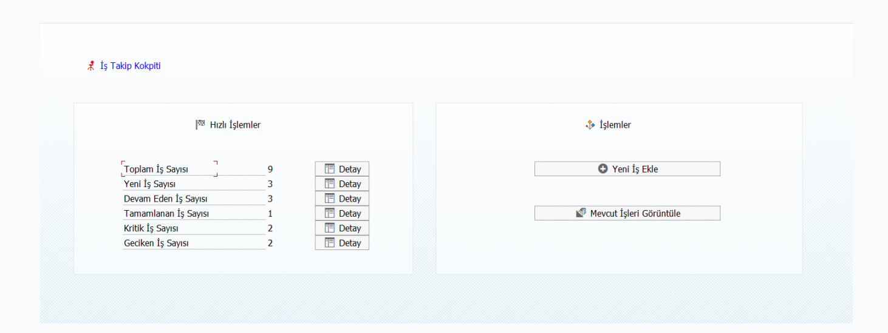
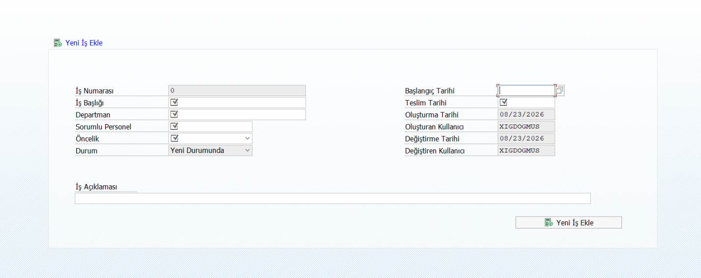
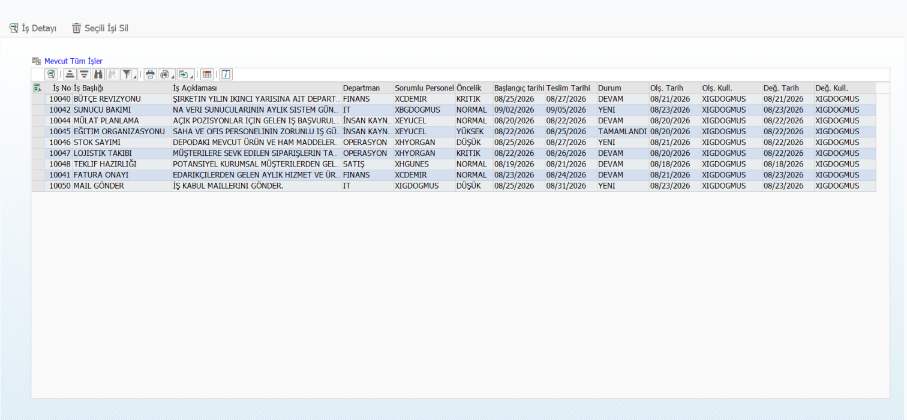
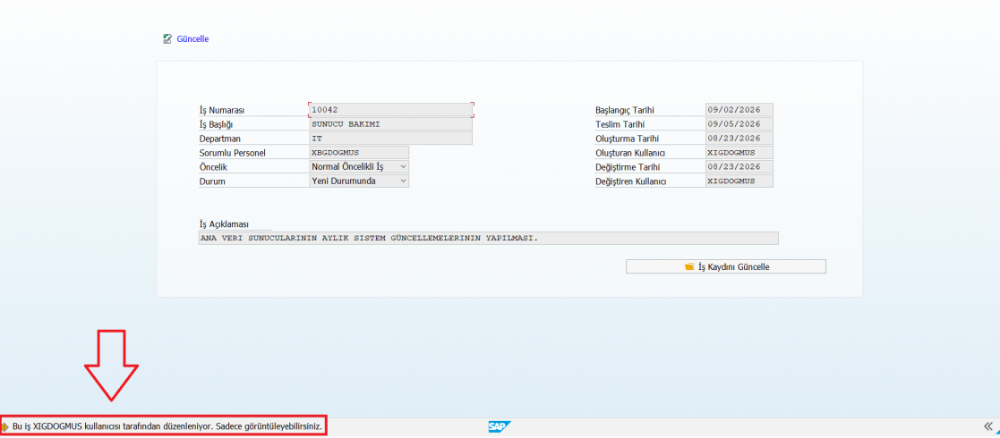
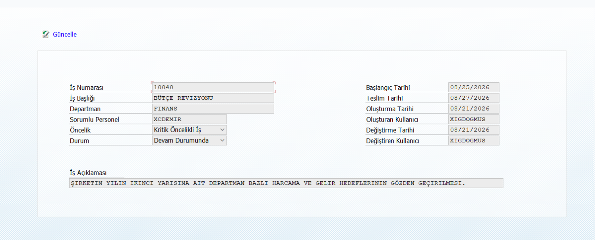

# ZIG_JOBS — Enterprise Job Tracking Cockpit / Kurumsal İş Takip Kokpiti

[🇬🇧 English](#english) | [🇹🇷 Türkçe](#türkçe)

---

## 🇬🇧 English

**Main Program:** `ZIG_JOB_COCKPIT` | **Transaction Code:** `ZIG_JOBS`  
An end-to-end SAP ABAP application for centrally managing departmental tasks, personnel assignments, priorities, and lifecycle statuses with strict concurrency and role-based security controls.

### System Architecture & Data Dictionary (SE11)
* **Database Tables:**
  * `ZIGT_JOBS` (`ZIGS_JOB` / Maintenance: `ZIG_JOBS_MAINTENANCE`): Core job records with automatic numbering.
  * `ZIGT_PERSONELS` (`ZIGS_PERSONEL` / Maintenance: `ZIG_PERSONELS_MAINTE`): Personnel master data with Active/Passive status.
  * `ZIGT_DEPARTMENTS` (`ZIGS_DEPARTMENT` / Maintenance: `ZIG_DEPS_MAINTENANCE`): Validated department definitions.
* **Number Range (`SNRO`):** `ZIG_JOB_NO` integrated via `NUMBER_GET_NEXT` in both the cockpit UI and Table Maintenance Events.
* **Lock Object:** `EZ_ZIGT_JOBS` (`ENQUEUE_EZ_ZIGT_JOBS` / `DEQUEUE_EZ_ZIGT_JOBS`) prevents concurrent editing on Dynpro `0109`.
* **Search Help:** `ZIG_HV_PERSONELS` (Help View) + `ZIG_SH_PERSONEL` ensures only **Active** personnel can be assigned.
* **Authorization:** Custom object `ZIG_J_AUTH` (Class `ZIGC`) separating `ZIG_JOB_ADMIN` and `ZIG_JOB_USER` roles in both PBO and PAI.

### Object-Oriented ABAP Design (SE24)

| Class | Key Methods | Responsibility |
|---|---|---|
| `ZIGCL_JOP_MANAGER` | `create_new_job`, `update_job`, `delete_jobs`, `get_all_jobs`, `get_criticial_jobs`, `get_delayed_jobs` | Full CRUD operations and status/priority-based data retrieval. |
| `ZIGCL_JOP_ANALYTICS` | `get_total_jobs_count`, `get_delayed_jobs_count`, `get_criticial_jobs_count`, `get_ongoing_jobs_count` | Real-time KPI calculations for the main dashboard. |
| `ZIGCL_JOB_UTILITIES` | `check_start_due_date` | Business rule validations (date consistency, status transitions). |

### Verified Test Scenarios

| ID | Test Case | Expected Behavior | Result |
|---|---|---|---|
| **T1** | Invalid date range (`Due Date < Start Date`) | Error message raised; save blocked | Passed |
| **T2** | Assigning a passive employee | Excluded automatically via `ZIG_SH_PERSONEL` | Passed |
| **T3** | Standard user attempting to delete another user's job | Blocked in PAI via `AUTHORITY-CHECK` (`ZIG_J_AUTH`) | Passed |
| **T4** | Deleting a Completed or Cancelled job | Blocked with business rule error message | Passed |
| **T5** | Concurrent edit by two users | `ENQUEUE_EZ_ZIGT_JOBS` locks record in display-only mode | Passed |

---

## 🇹🇷 Türkçe

**Ana Program:** `ZIG_JOB_COCKPIT` | **İşlem Kodu (T-Code):** `ZIG_JOBS`  
Şirket bünyesindeki departmanların iş kayıtlarını merkezi bir SAP ortamında uçtan uca yönetmek, personellere atamak, öncelik ve durumlarını eşzamanlılık (kilit) ve rol bazlı yetki kontrolleriyle takip etmek için geliştirilmiştir.

### Sistem Mimarisi ve Veri Sözlüğü (SE11)
* **Veritabanı Tabloları:**
  * `ZIGT_JOBS` (`ZIGS_JOB` / Bakım: `ZIG_JOBS_MAINTENANCE`): Otomatik numaralandırmalı ana iş kayıtları tablosu.
  * `ZIGT_PERSONELS` (`ZIGS_PERSONEL` / Bakım: `ZIG_PERSONELS_MAINTE`): Aktif/Pasif durumlu personel ana verisi.
  * `ZIGT_DEPARTMENTS` (`ZIGS_DEPARTMENT` / Bakım: `ZIG_DEPS_MAINTENANCE`): Departman tanımları.
* **Numara Aralığı (`SNRO`):** `ZIG_JOB_NO` nesnesi, `NUMBER_GET_NEXT` ile hem kokpit ekranına hem de Bakım Tablosu olaylarına (Events) entegre edilmiştir.
* **Kilit Nesnesi (Lock Object):** `EZ_ZIGT_JOBS` (`ENQUEUE` / `DEQUEUE`) ile Dynpro `0109` ekranında eşzamanlı düzenleme engellenir.
* **Arama Yardımcısı (Search Help):** `ZIG_HV_PERSONELS` ve `ZIG_SH_PERSONEL` ile yalnızca **Aktif** personellerin seçilmesi sağlanır.
* **Yetkilendirme:** `ZIGC` sınıfı altındaki `ZIG_J_AUTH` yetki nesnesi ile Yönetici (`ZIG_JOB_ADMIN`) ve Normal Kullanıcı (`ZIG_JOB_USER`) rolleri PBO ve PAI adımlarında ayrıştırılmıştır.

### Nesne Yönelimli ABAP Mimarisi (SE24)

| Sınıf | Temel Metotlar | Sorumluluk |
|---|---|---|
| `ZIGCL_JOP_MANAGER` | `create_new_job`, `update_job`, `delete_jobs`, `get_all_jobs`, `get_criticial_jobs`, `get_delayed_jobs` | Tüm CRUD işlemleri ve durum/öncelik bazlı kayıt sorgulamaları. |
| `ZIGCL_JOP_ANALYTICS` | `get_total_jobs_count`, `get_delayed_jobs_count`, `get_criticial_jobs_count`, `get_ongoing_jobs_count` | Ana kokpit (Dashboard) için anlık KPI hesaplamaları. |
| `ZIGCL_JOB_UTILITIES` | `check_start_due_date` | Tarih tutarlılığı ve iş kuralı doğrulamaları. |

### Doğrulanan Test Senaryoları

| No | Test Senaryosu | Beklenen Sonuç | Durum |
|---|---|---|---|
| **T1** | Geçersiz tarih aralığı (`Son Teslim < Başlangıç`) | Hata mesajı verilir ve kayıt engellenir | Başarılı |
| **T2** | Pasif personele iş atanması | `ZIG_SH_PERSONEL` arama yardımcısında listelenmez | Başarılı |
| **T3** | Normal kullanıcının başka işi silmeye çalışması | PAI `AUTHORITY-CHECK` (`ZIG_J_AUTH`) ile engellenir | Başarılı |
| **T4** | Tamamlanmış veya İptal işin silinmesi | İş kuralı hatası dönülerek engellenir | Başarılı |
| **T5** | Aynı işin iki farklı kullanıcıca açılması | `ENQUEUE_EZ_ZIGT_JOBS` ile sadece görüntüleme modunda açılır | Başarılı |

---

## Screenshots / Ekran Görüntüleri

### 1. Main Cockpit & Dashboard / Ana Kokpit (Dynpro 101)

### 2. Job Creation (Dynpro 102) & ALV List (Dynpro 103)

### 3. Lock Object & Authorization Controls / Kilit ve Yetki Kontrolleri (Dynpro 109)

📄 **Full Technical Report / Detaylı Proje Raporu:** [GUI-SAP_ABAP_JOB_COCKPIT.pdf](./docs/GUI-SAP_ABAP_JOB_COCKPIT.pdf)
